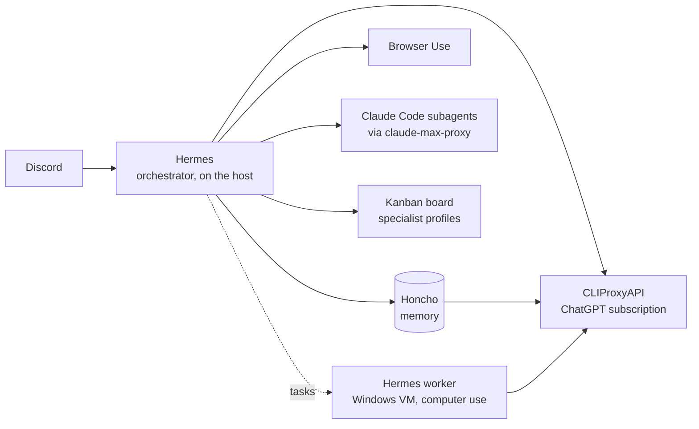

# agent-ops-kit

One controller, one chat surface, no API keys. Hermes runs your agent estate
from Discord: long-term memory in Honcho, browsing through Browser Use, coding
delegated to Claude Code, desktop work handed to a worker in a Windows VM, and
specialist agents with their own knowledge collaborating on a Kanban board.
Everything runs on the subscriptions you already have (ChatGPT and Claude Max)
through two local proxies.



## Quick start

On a Linux host with Docker:

```bash
git clone https://github.com/NorkzYT/agent-ops-kit.git /opt/agent-ops-kit
cd /opt/agent-ops-kit
make init                 # .env with secrets, CLIProxyAPI config
make up                   # Honcho + Ollama + CLIProxyAPI (Docker)
make auth-codex           # sign in with the ChatGPT account
make claude-proxy-install # claude-max-proxy on the host, as a systemd user service
make auth-claude-proxy    # sign in with the Claude Max account (token stored in .env)
$EDITOR .env              # DISCORD_BOT_TOKEN, DISCORD_ALLOWED_USERS, DISCORD_HOME_CHANNEL
make hermes-install       # install Hermes, wire it up, start the Discord gateway
make doctor
```

Then @mention the bot in Discord. Full walkthrough: [docs/install.md](docs/install.md).
`make help` lists every target, grouped by area (colored on a terminal;
`COLOR=0`/`NO_COLOR=1` turn it off, `COLOR=1` forces it, `HELP_WIDTH=<n>` sets the wrap width).

## Change a setting

`.env` in the checkout is the source of truth; `~/.hermes` is rendered from it.
Run these from your own terminal, not from a Hermes or Discord turn:

```bash
$EDITOR .env
bash scripts/hermes-install.sh --render-only /tmp/hermes-next.yaml   # preview; nothing written
diff ~/.hermes/config.yaml /tmp/hermes-next.yaml
make hermes-config-apply      # HERMES_SKIP_GATEWAY=1 bash scripts/hermes-install.sh --force; no restart
make local-route-readback     # live config matches the render
make hermes-restart           # the gateway picks up the new config
make router-logs LINES=5      # "model_router registered (privacy=... specialists=on) ..."
```

`hermes-config-apply` rewrites `config.yaml`, `SOUL.md` and `honcho.json`
(keeping `.bak` copies), refreshes the skills and plugins, and leaves the
gateway running on the old config until `make hermes-restart`. Details:
[docs/install.md](docs/install.md#change-a-setting).

## Model routing

All of this lives in the `model-router` plugin and `.env`; see
[docs/model-routing.md](docs/model-routing.md).

- **Orchestrator** (CLIProxyAPI, ChatGPT): per task, status→`gpt-5.6-luna`
  low effort, ordinary work→luna, planning→`gpt-6.1-terra`, hard→`gpt-5.6-sol`;
  `gpt-6-astra` only with a leading `#max`/`#astra` line.
- **Coding subagents** (claude-max-proxy, Claude Max): `opus`, `fable` for hard
  engineering; a leading `#opus`/`#fable` line forces one.
- **Specialists**: the router names up to six book-backed profiles per task
  (`MODEL_ROUTER_SPECIALIST_MAX=6`, the hard cap). Keywords and verified
  attachment text (PDF/DOCX extracted locally) add deterministic signals; for
  weak matches or attachments the classifier on CLIProxyAPI `gpt-6.1-terra`
  (medium effort) may add up to two more, within the same cap.
- **Compression**: CLIProxyAPI `gpt-6.1-terra`, falling back to `gpt-5.6-luna`.
- **Session titles**: the main route (CLIProxyAPI, luna); no title variables
  are set in `.env.example`.
- **Privacy**: `#privacy` or `#private` typed in the current turn keeps that
  request on local Ollama or refuses it (per request, not sticky; `#local`
  does nothing). This needs `MODEL_ROUTER_PRIVACY=true`. `.env.example`
  currently ships `MODEL_ROUTER_PRIVACY=false`, the opt-out: the main-loop
  guard is off, so marked turns follow the normal cloud route. Even then,
  compression refuses a payload carrying `#privacy`/`#private`, and marked
  turns never reach the specialist classifier.

## What is in the box

| Piece | Where it runs | What it does |
|-------|---------------|--------------|
| Hermes | host, `~/.hermes` | the agent: Discord gateway, tools, cron, delegation, profiles, Kanban |
| Honcho | Docker | long-term memory of you, self-hosted, reasoning via your ChatGPT subscription |
| Ollama | Docker | local embedding model for Honcho, so no embeddings API key |
| CLIProxyAPI | Docker `:8317` | ChatGPT subscription as an OpenAI-compatible API |
| claude-max-proxy | host, systemd user service `:3456` | Claude Max subscription as an OpenAI-compatible API; runs Claude Code on the host, so subagents get your repos, toolchains, docker and gh |
| Browser Use | host (or Cloud) | the browser backend Hermes drives |
| Windows worker | your VM | a second Hermes with computer use for GUI-only tasks |
| `.claude/` kit | any repo | hooks, agents and skills that make Claude Code a careful coding worker |

## How a task flows

1. You ask in Discord. Hermes checks memory, triages, and picks a route.
2. Coding goes to a Claude subagent (`delegate_task`) that follows the `coder`
   profile: triage, plan, implement, verify, commit on a branch, report.
3. Web work uses the browser tools; you handle logins and MFA.
4. Desktop-only work becomes a Kanban task for `windows-operator`.
5. Specialist questions (marketing, strategy, security, research) become
   Kanban tasks for those profiles; the orchestrator synthesises one answer.
6. Hermes verifies before it says done, and writes what it learned to Honcho.

## Specialist agents

Each profile is a folder with a `SOUL.md` and a `knowledge/` directory. Feed
it books as `.md` or `.txt`, run `/learn`, and it answers from them with
citations. Give it a Discord bot of its own if you want to talk to it directly.
Teams are pipelines on the Kanban board: research, draft, critique, revise,
final. See [docs/profiles-and-teams.md](docs/profiles-and-teams.md).

```bash
make hermes-profile NAME=marketing
hermes kanban create "Positioning for the new plan" --assignee marketing
```

Book-backed profiles list their books in `hermes/profiles/<name>/knowledge-sources.txt`.
After adding books to `/mnt/books`, check what is unlisted, have a model
propose a profile for each (dry-run), approve or apply, refresh, then `/learn`
in each `updated` profile. See [docs/knowledge-refresh.md](docs/knowledge-refresh.md)
and [docs/knowledge-classify.md](docs/knowledge-classify.md); both have a
Discord prompt template.

```bash
make knowledge-inventory     # read-only: uncategorized, already imported (by content), missing sources
make knowledge-classify      # AI proposals + reviewed plan plan-<report>.json (dry-run)
make knowledge-apply PLAN=plan-<report>.json APPROVE=1   # one command: assign, canonical copy once, refs, install, learn
make knowledge-reconcile     # proposal: link staged knowledge that has no book-list source
make knowledge-refresh       # legacy: stage + sync every profile (NAME=<profile> for one)
```

The plan flow is in [docs/knowledge-apply.md](docs/knowledge-apply.md).

## Repository layout

```
docker-compose.yml        Honcho, Ollama, CLIProxyAPI
Makefile                  every operator command, grouped in `make help` (stack, proxies, Hermes, routing, specialists, knowledge, tests)
.env.example              every setting, commented
scripts/                  stack-init, hermes-install, hermes-profile, doctor, claude-max-proxy/ (host install), windows-vm/
vendor/claude-max-api-proxy  vendored proxy sources (UPSTREAM pins the commit; make claude-proxy-update)
hermes/                   config templates, SOUL.md, profiles/, teams/, skills/, cron-jobs.md
docker/                   cliproxyapi config template, honcho init, ollama entrypoint
docs/                     install, hermes, honcho, proxies, browser-use, profiles, windows, troubleshooting
.claude/                  the Claude Code kit (installable into other repos with install.sh)
```

## Documentation

- [docs/install.md](docs/install.md), [docs/troubleshooting.md](docs/troubleshooting.md)
- [docs/hermes.md](docs/hermes.md), [docs/honcho.md](docs/honcho.md), [docs/proxies.md](docs/proxies.md)
- [docs/model-routing.md](docs/model-routing.md), [docs/specialist-routing.md](docs/specialist-routing.md)
- [docs/browser-use.md](docs/browser-use.md), [docs/profiles-and-teams.md](docs/profiles-and-teams.md), [docs/windows-vm-worker.md](docs/windows-vm-worker.md)
- Upstream: [Hermes](https://hermes-agent.nousresearch.com/docs), [Honcho](https://honcho.dev/docs), [Browser Use](https://docs.browser-use.com), [CLIProxyAPI](https://github.com/router-for-me/CLIProxyAPI), [claude-max-api-proxy](https://github.com/mattschwen/claude-max-api-proxy)

## The Claude Code kit

`.claude/` is the coding worker's rulebook: a bash guard, protected files,
auto-format, session logging, staged agents (autopilot, triage, fixer,
closer), skills, and an eval harness. It installs into any repo:

```bash
curl -fsSL https://raw.githubusercontent.com/NorkzYT/agent-ops-kit/main/install.sh \
  | bash -s -- --repo NorkzYT/agent-ops-kit --ref main --force
```

Details in [docs/workflow.md](docs/workflow.md) and `.claude/CLAUDE.md`.

## Principles

1. One controller. Hermes decides; everything else is a tool or a worker.
2. Subscriptions, not API keys. The proxies are adapters and can be swapped.
3. You own logins, MFA, purchases and anything public. The agents wait.
4. Verify before "done". Tests run, pages open, files read back.
5. Smallest change that satisfies the task. Feature branches, never `main`.

## Contributors

Thanks to [@Breadfishman](https://github.com/Breadfishman) for close collaboration on the earlier Claude Code kit that this repo grew out of.

## License

GPL-3.0. See [LICENSE](LICENSE).
