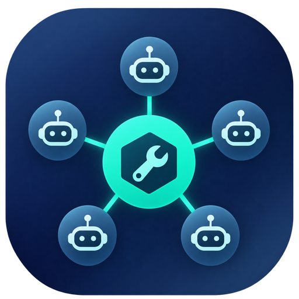
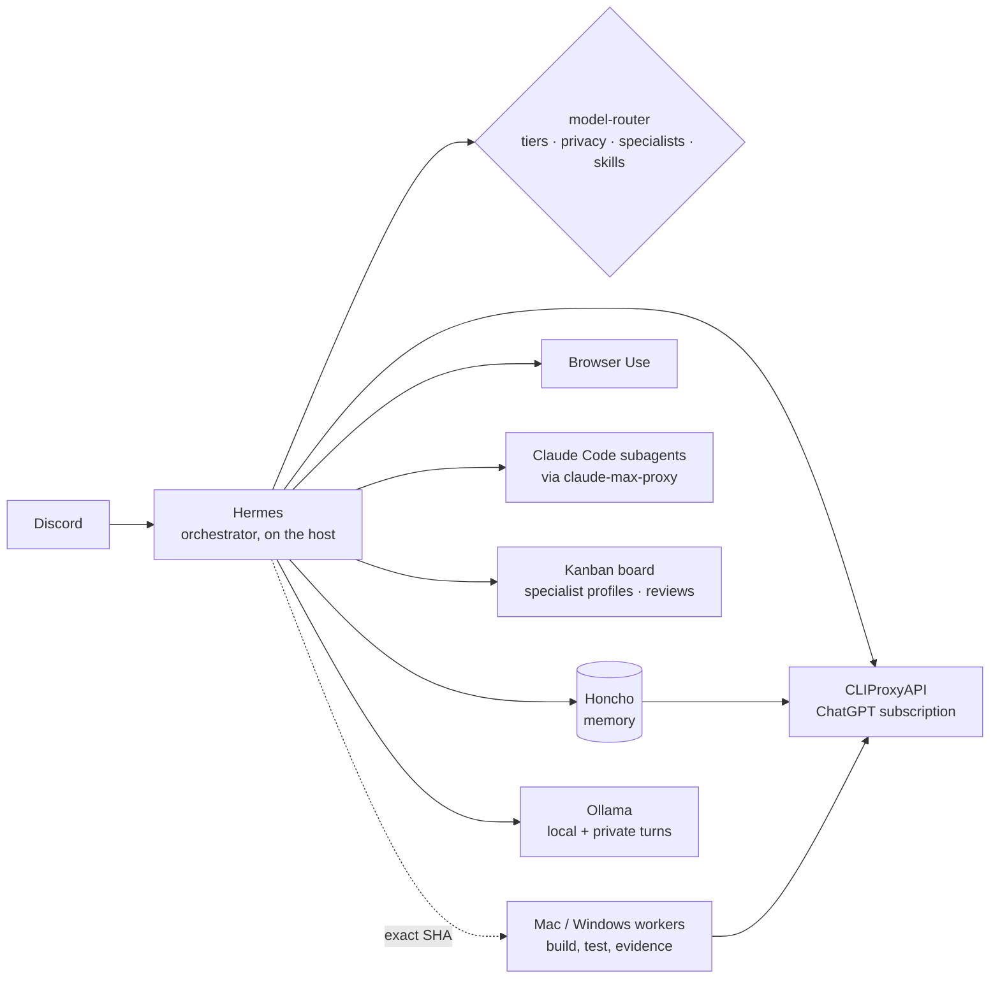

<p align="center">
  
</p>

<h1 align="center">agent-ops-kit</h1>

<p align="center">
  <b>One controller. One chat surface. No API keys.</b><br>
  Run a team of AI agents from Discord on the ChatGPT and Claude Max subscriptions you already pay for.
</p>

<p align="center">
  <a href="#quick-start">Quick start</a> ·
  <a href="#what-it-can-do">What it can do</a> ·
  <a href="#capability-skills-gstack-and-pm-methods">gstack + PM skills</a> ·
  <a href="#engineering-workflow">Engineering workflow</a> ·
  <a href="#marketing-video-and-ui-audits">Video + UI audits</a> ·
  <a href="docs/README.md">Docs</a>
</p>

---

agent-ops-kit turns one Linux host into an agent estate you drive from Discord.
[Hermes](https://hermes-agent.nousresearch.com/docs) is the single controller.
It keeps long-term memory in Honcho, browses with Browser Use, hands coding to
Claude Code, sends desktop and device work to Mac and Windows workers, and asks
book-trained specialist agents for advice on a Kanban board. Two local proxies
turn your ChatGPT and Claude Max subscriptions into OpenAI-compatible APIs, thus
nothing needs a paid API key.



## What it can do

| Area | What you get |
|------|--------------|
| **Chat control** | Ask in Discord; Hermes triages, routes, verifies and reports in the same thread. |
| **Model routing** | Per-task model tiers, `#sol` / `#max` / `#opus` / `#fable` overrides, `#private` turns kept on local Ollama. |
| **Coding** | Claude Code (Opus, Fable) writes on a feature branch, tests, commits and pushes. |
| **Engineering workflow** | Discord → Kanban → one writer → Mac/Windows/BrowserStack evidence on an exact SHA → independent review → report. |
| **Product + design methods** | Twelve capability skills adapted from [gstack](https://github.com/garrytan/gstack) and [PM Skills](https://github.com/phuryn/pm-skills): problem definition, discovery, PRD, specs, plan reviews, design, code review, QA, competitor research. |
| **Specialists** | 20+ book-backed profiles (strategy, marketing, security, research, negotiation, ...) that learn from your books and answer with citations. |
| **Knowledge pipeline** | EPUB/PDF → Markdown, AI-proposed profile placement, reviewed apply, and `/learn` into a per-profile skill. |
| **Memory** | Self-hosted Honcho keeps what it learns about you across sessions. |
| **Desktop + devices** | A Windows worker with computer use, a Mac worker for Xcode and simulators. |
| **Marketing video** | Videos from screenshots, facts and brand assets, rendered locally with pinned HyperFrames by default; claims and asset-rights gates check the recorded facts and provenance before every render, then ffprobe QA. A pass is not proof of rights beyond those records. Remotion stays as an explicit legacy lane. |
| **UI audits** | Opt-in, project-local axe-core, Lighthouse CI and Impeccable (advisory) runs on your own built static pages, with reports kept on disk. |
| **Browser pilot** | BrowserOS neo in Docker with a noVNC viewer and Hermes MCP; opt-in (`up`, then a separate `hermes-enable`), ports published on loopback only but not isolated from other host processes; real-account login is NO-GO. |
| **Claude Code kit** | `.claude/` hooks, agents and skills that make Claude Code a careful worker in any repo. |

## Quick start

On a Linux host with Docker:

```bash
git clone https://github.com/NorkzYT/agent-ops-kit.git /opt/agent-ops-kit
cd /opt/agent-ops-kit
make init                 # .env with secrets, CLIProxyAPI config
make up                   # Honcho + Ollama + CLIProxyAPI (Docker)
make auth-codex           # sign in with the ChatGPT account
make claude-proxy-install # claude-max-proxy on the host, as a systemd user service
make auth-claude-proxy    # sign in with the Claude Max account (token stored in .env)
$EDITOR .env              # DISCORD_BOT_TOKEN, DISCORD_ALLOWED_USERS, DISCORD_HOME_CHANNEL
make hermes-install       # install Hermes, wire it up, start the Discord gateway
make doctor
```

Then @mention the bot in Discord. Full walkthrough: [docs/install.md](docs/install.md).
These steps assume a Linux host with Docker, systemd user services, and your
own ChatGPT, Claude Max and Discord accounts. Other setups may need changes;
`make doctor` and [docs/troubleshooting.md](docs/troubleshooting.md) show what
is missing. The quick start does not install the optional pilots below.
`make help` lists every target, grouped by area (colored on a terminal;
`COLOR=0`/`NO_COLOR=1` turn it off, `COLOR=1` forces it, `HELP_WIDTH=<n>` sets the wrap width).

### Update an existing install

```bash
git pull
make update               # newer images, restart containers, rebuild + restart claude-max-proxy
make hermes-config-apply  # re-render ~/.hermes from .env, refresh skills and plugins (no restart)
make hermes-restart       # the gateway loads the new config, skills and router
make doctor
```

`hermes-config-apply` copies the repo's `model-router` plugin over the
installed one, and `hermes-restart` interrupts running turns. Run both from
your own terminal at a quiet moment.

### Optional: video and UI-audit tools

The HyperFrames video lane and the UI-audit pilot install separately, into
`tools/<tool>/node_modules` from tracked lockfiles (`npm ci --ignore-scripts`,
nothing global, no hooks, no Hermes config changes, no restart):

```bash
make tool-pilots-check                              # Node 22+, npm, Chrome, FFmpeg, installed pins; downloads nothing
TOOL_PILOTS_ALLOW_DOWNLOADS=1 make tool-pilots-install  # opt-in download from the npm registry
```

`TOOLS=ui-audit` or `TOOLS=hyperframes` limits either command to one pilot.
See [docs/tool-pilots.md](docs/tool-pilots.md).

## Change a setting

`.env` in the checkout is the source of truth; `~/.hermes` is rendered from it.
Run these from your own terminal, not from a Hermes or Discord turn:

```bash
$EDITOR .env
bash scripts/hermes-install.sh --render-only /tmp/hermes-next.yaml   # preview; nothing written
diff ~/.hermes/config.yaml /tmp/hermes-next.yaml
make hermes-config-apply      # HERMES_SKIP_GATEWAY=1 bash scripts/hermes-install.sh --force; no restart
make local-route-readback     # live config matches the render
make hermes-restart           # the gateway picks up the new config
make router-logs LINES=5      # "model_router registered (privacy=... specialists=on) ..."
```

`hermes-config-apply` rewrites `config.yaml`, `SOUL.md` and `honcho.json`
(keeping `.bak` copies), refreshes the skills and plugins, and leaves the
gateway running on the old config until `make hermes-restart`. Details:
[docs/install.md](docs/install.md#change-a-setting).

## Model routing

All of this lives in the `model-router` plugin and `.env`; see
[docs/model-routing.md](docs/model-routing.md).

- **Orchestrator** (CLIProxyAPI, ChatGPT): starts on `HERMES_MODEL`
  (default `gpt-6.1-terra`, `model.default`); the router then rewrites
  per task: status/lookup→`gpt-5.6-luna` (low effort), ordinary work and
  planning→`gpt-6.1-terra` (medium), genuinely hard work or a leading `#sol`
  line→the newest Sol CLIProxyAPI advertises (static `gpt-6.1-sol` when the
  live catalog is unavailable); Astra (newest live, static `gpt-6-astra`)
  only with a leading `#max`/`#astra` line. Automatic routing never goes
  above Sol.
- **Coding subagents** (claude-max-proxy, Claude Max): `opus` by default,
  `fable` for hard engineering; a leading `#opus`/`#fable` line forces one.
- **Specialists**: `.env.example` turns specialist routing on in `ai` mode
  (`MODEL_ROUTER_SPECIALISTS=true`, `MODEL_ROUTER_SPECIALIST_MODE=ai`). The
  classifier on CLIProxyAPI `gpt-6.1-terra` (medium effort) picks from the
  eligible installed profiles, reading the typed task plus locally extracted
  PDF/DOCX text, up to `MODEL_ROUTER_SPECIALIST_MAX=6` (the setting allows
  0-15). There is no keyword scoring and no fallback: a classifier failure or
  timeout selects none. Deterministic code still enforces privacy, the
  allowlist, readiness and the cap. Keyword (`keywords`) and keywords-first
  (`hybrid`) modes are opt-in; see
  [docs/specialist-routing.md](docs/specialist-routing.md).
- **Compression**: CLIProxyAPI `gpt-6.1-terra`, falling back to `gpt-5.6-luna`.
- **Session titles**: the main route (CLIProxyAPI, `HERMES_MODEL`); no title variables
  are set in `.env.example`.
- **Privacy**: `#privacy` or `#private` typed in the current turn keeps that
  request on local Ollama or refuses it (per request, not sticky; `#local`
  does nothing). This needs `MODEL_ROUTER_PRIVACY=true`. `.env.example`
  currently ships `MODEL_ROUTER_PRIVACY=false`, the opt-out: the main-loop
  guard is off, so marked turns follow the normal cloud route. Even then,
  compression refuses a payload carrying `#privacy`/`#private`, and marked
  turns never reach the specialist classifier.

## Capability skills (gstack and PM methods)

Twelve Hermes skills bring product, design and engineering methods into the
same chat. Once they are activated (see the end of this section), Hermes
picks one from a plain request ("help me figure out why bookings dropped");
you do not need to name it.

| Skill | Use it when |
|-------|-------------|
| `problem-definition` | a vague problem needs an evidenced decision brief |
| `pm-product-discovery` | an accepted problem needs ideas, risks and tests |
| `pm-lean-prd` | an accepted opportunity needs a lean, testable PRD |
| `pm-competitor-research` | you need cited, dated competitor and market comparisons |
| `gstack-office-hours` | you want to test demand, users and approach before a PRD |
| `gstack-spec` | accepted requirements or a bug need a spec |
| `gstack-plan-eng-review` | a PRD or spec needs an engineering review before build |
| `gstack-plan-design-review` | a UI plan needs a designer's review before build |
| `gstack-design-consultation` | an accepted brief needs a design system and an offline preview |
| `gstack-design-review` | a design or existing UI needs an evidence-bound audit |
| `gstack-review` | an exact diff needs an independent pre-landing audit |
| `gstack-qa` | a feature needs functional QA with replayable evidence |

How they are built:

- **Methods, not runtimes.** Each skill adapts the method from a pinned,
  hash-verified upstream file. No gstack script, binary, hook, browser, telemetry
  or `ship` step runs. Upstream licenses ship with each skill.
- **Evidence first.** Every artifact separates facts, assumptions, hypotheses and
  unknowns, is checked by a validator, and goes stale when its inputs change.
  Synthetic examples are never presented as customer research.
- **Advice, not action.** Audits report findings; they do not edit code, file
  issues or publish anything.
- **Registry.** `hermes/capabilities/registry.json` lists 16 capabilities (12
  implemented, 2 planned, 2 existing paths) with their contracts and readiness.

```bash
make capability-validate          # registry, lock, schemas, synthetic manifests
make capability-plan TASK=task.json CAPS="pm.lean-prd" FORMAT=summary
make capability-compat            # read-only: skills vs the installed Hermes
make test-capabilities
```

`make hermes-install` does not copy these skills; their activation is gated,
and until it runs Hermes cannot use them.
See [docs/capability-registry.md](docs/capability-registry.md) and
[docs/capability-activation.md](docs/capability-activation.md).

## Engineering workflow

Work that a Mac or Windows machine must build or test follows one path, with
every step as a Kanban card so it survives restarts:

1. The coordinator (Claude Opus or Fable) writes the code, commits, pushes the
   feature branch and records the exact 40-character SHA.
2. The Mac and Windows workers check out that SHA, build, test, install, launch
   and return evidence. They never edit, commit or push.
3. A failed lane starts the next fix round. When every lane passes, an
   independent reviewer checks the exact diff and the evidence.
4. The report goes back to the same Discord thread. Merges, releases and store
   submissions wait for your approval.

iOS and iPad apps add simulator, BrowserStack and real-device stages.

```bash
make workflow-status ID=t_xxxx   # every card, round, SHA, lane evidence, review
make workflow-gate ID=t_xxxx     # exit 0 only if the final SHA passed every lane and review
```

Details: [docs/discord-kanban-workflow.md](docs/discord-kanban-workflow.md),
[docs/mobile-validation.md](docs/mobile-validation.md),
[docs/engineering-completion.md](docs/engineering-completion.md).

## Marketing video and UI audits

**Marketing video.** With the quick start's skills installed and the
HyperFrames lane installed (see "Optional: video and UI-audit tools"), ask
Hermes for a marketing, promo or demo video and the `marketing-video-system`
skill drives it; the `marketing` profile follows the
same skill and [marketing-video-team](hermes/teams/marketing-video-team.md) is
the full pipeline. New videos render with HyperFrames (`hyperframes@0.9.80`, pinned
and run locally); `ENGINE=remotion` selects the legacy Remotion lane, which
installs separately with `ENGINE=remotion make marketing-video-install`. There
is no fallback between engines: if the chosen one fails, the command fails.

```bash
make marketing-video-gates PROPS=... PROVENANCE=... OUT=...   # claims, rights and project-asset gates; builds the project, renders nothing
make marketing-video-render                                   # gates, then render + QA (tracked synthetic sample by default)
make test-marketing-video                                     # offline gate/builder tests, no render
```

Before anything renders, every numeric or superlative on-screen claim needs
an evidenced fact, every used asset (fonts included) needs a provenance record
cleared for commercial use, and the built project is scanned for remote URLs,
CDN scripts and uncleared files. The gates check what the records say; they do
not prove the rights themselves. The video is an artifact only; publishing
waits for your approval. Limits: Chrome sends non-loopback requests to a dead
proxy, but this is not network isolation, and no test proves a render makes no
outbound connection; renders use software GL and take minutes; the sample font
needs the host's `fonts-liberation` file. Details:
[docs/marketing-video.md](docs/marketing-video.md).

**UI audits.** Point the pilot at your own built static pages:

```bash
make ui-audit-project PROJECT=/abs/path/to/dist PAGES=index.html,pricing/index.html
make ui-audit                  # owned fixtures; seeded defects make it exit 2 by design
make test-ui-audit-pilot       # real tools on 127.0.0.1 fixtures; needs the install and Chrome
```

The pilot serves only `PROJECT` on `127.0.0.1`, writes a new report directory
per run, never writes into `PROJECT`, and uploads nothing (Lighthouse CI uses
the filesystem target). axe and Lighthouse failures fail the run; Impeccable
findings are advisory design heuristics and never fail it. Limits: a clean
scan is not accessibility sign-off (keyboard, focus and screen-reader checks
stay manual; axe `incomplete` results need review), Lighthouse asserts only
accessibility and SEO, not performance, there is no network isolation, and
dev servers and client-routed SPAs are out of scope (audit the built output).
Details: [docs/tool-pilots.md](docs/tool-pilots.md),
[tools/ui-audit-pilot/README.md](tools/ui-audit-pilot/README.md).

## What ships vs what is running

Everything here is source in this repo. What is active on a given host depends
on what the operator ran:

| State | What | How it becomes active |
|-------|------|-----------------------|
| Installed by the quick start | Docker stack, both proxies, Hermes config, the model-router plugin, non-capability skills (`kanban-workflow`, `marketing-video-system`, `document-converter`, ...) | `make up`, `make claude-proxy-install`, `make hermes-install` |
| Configured by the quick start | specialist routing (`ai` mode, `.env.example` ships `MODEL_ROUTER_SPECIALISTS=true`); profiles route only once installed | `make init` copies the setting, `make hermes-install` renders it; `make specialist-install` / `specialist-enable` change it later |
| Applied on update | changed config, skills and plugins | `make hermes-config-apply`, then `make hermes-restart` |
| Gated | the twelve gstack/PM capability skills | [docs/capability-activation.md](docs/capability-activation.md) |
| Opt-in pilots | HyperFrames video lane, UI-audit pilot, Remotion legacy lane, BrowserOS neo | `make tool-pilots-install` (with `TOOL_PILOTS_ALLOW_DOWNLOADS=1`); `ENGINE=remotion make marketing-video-install`; `make browseros-neo-up`, then separately `make browseros-neo-hermes-enable APPROVE_ACTIVATION=yes` ([docs/browseros-neo.md](docs/browseros-neo.md)) |
| Your machines | Mac and Windows workers | [docs/windows-vm-worker.md](docs/windows-vm-worker.md), [docs/mobile-validation.md](docs/mobile-validation.md) |

`make doctor`, `make specialist-status`, `make capability-compat` and
`make tool-pilots-check` report what is actually installed; a skill or tool in
the repo is not proof that it is live. The quick start copies the
`browseros-neo-browser` skill, but that is not the activated pilot: Hermes
leaves it out of the skills index until Neo's MCP tools are registered.

## What is in the box

| Piece | Where it runs | What it does |
|-------|---------------|--------------|
| Hermes | host, `~/.hermes` | the agent: Discord gateway, tools, cron, delegation, profiles, Kanban |
| model-router | Hermes plugin | per-task model tier, privacy guard, specialist and capability selection |
| Honcho | Docker | long-term memory of you, self-hosted, reasoning via your ChatGPT subscription |
| Ollama | Docker | local embeddings for Honcho, and the local model for `#private` turns |
| CLIProxyAPI | Docker `:8317` | ChatGPT subscription as an OpenAI-compatible API |
| claude-max-proxy | host, systemd user service `:3456` | Claude Max subscription as an OpenAI-compatible API; runs Claude Code on the host, so subagents get your repos, toolchains, docker and gh |
| Browser Use | host (or Cloud) | the browser backend Hermes drives |
| Mac / Windows workers | your machines | their own Hermes; build, test and computer use for GUI-only tasks |
| `.claude/` kit | any repo | hooks, agents and skills that make Claude Code a careful coding worker |
| HyperFrames video lane | host, `tools/hyperframes-marketing` (opt-in) | local marketing-video renders behind claims, rights and asset gates; Remotion legacy lane in `tools/remotion-marketing` |
| UI-audit pilot | host, `tools/ui-audit-pilot` (opt-in) | axe-core, Lighthouse CI and Impeccable on static pages served on 127.0.0.1 |
| BrowserOS neo | Docker, ports published on 127.0.0.1 only (opt-in pilot; not isolated from host processes) | one persistent browser profile, noVNC viewer, Hermes MCP after a separate `hermes-enable` |

## How a task flows

1. You ask in Discord. Hermes checks memory, triages, and picks a route.
2. The model-router picks the model tier and suggests specialists and skills.
3. Coding goes to a Claude subagent (`delegate_task`) that follows the `coder`
   profile: triage, plan, implement, verify, commit on a branch, report.
4. Web work uses the browser tools; you handle logins and MFA.
5. Device and desktop work goes through the engineering workflow or the
   `windows-operator` profile.
6. Specialist questions become Kanban tasks for those profiles; Hermes waits
   for their reviews and writes one answer.
7. Hermes verifies before it says done, and writes what it learned to Honcho.

## Specialist agents

Each profile is a folder with a `SOUL.md` and a `knowledge/` directory. Feed
it books as `.md` or `.txt`, run `/learn`, and it answers from them with
citations. Give it a Discord bot of its own if you want to talk to it directly.
Teams are pipelines on the Kanban board: research, draft, critique, revise,
final. See [docs/profiles-and-teams.md](docs/profiles-and-teams.md).

```bash
make hermes-profile NAME=marketing
hermes kanban create "Positioning for the new plan" --assignee marketing
```

Book-backed profiles list their books in `hermes/profiles/<name>/knowledge-sources.txt`.
After adding books to `/mnt/books`, check what is unlisted, have a model
propose a profile for each (dry-run), approve, then learn:

```bash
make knowledge-inventory     # read-only: uncategorized, already imported (by content), missing sources
make knowledge-classify      # AI proposals + reviewed plan plan-<report>.json (dry-run)
make knowledge-apply PLAN=plan-<report>.json APPROVE=1   # assign, canonical copy once, refs, install, learn
make knowledge-learn-status  # raw knowledge vs learned <profile>-knowledge skill
```

More: [docs/knowledge-apply.md](docs/knowledge-apply.md),
[docs/knowledge-classify.md](docs/knowledge-classify.md),
[docs/knowledge-refresh.md](docs/knowledge-refresh.md),
[docs/document-conversion.md](docs/document-conversion.md).

## Safety model

- **You own the boundary.** Logins, MFA, purchases, merges, releases and anything
  public wait for your approval.
- **Private stays local.** `#private` turns run on local Ollama or are refused,
  and never reach a cloud classifier.
- **Fail closed.** Gated installs, unready tools and missing evidence stop the
  work instead of guessing. The dev-test runner stays disabled until its
  isolation design is approved ([docs/dev-test-runner.md](docs/dev-test-runner.md)).
- **Evidence over claims.** Tests run, pages open, files read back, and the
  workflow gate checks the exact SHA.

## Repository layout

```
docker-compose.yml        Honcho, Ollama, CLIProxyAPI
Makefile                  every operator command, grouped in `make help`
.env.example              every setting, commented
scripts/                  installers, routing, knowledge, capability and workflow tools + tests
vendor/claude-max-api-proxy  vendored proxy sources (UPSTREAM pins the commit; make claude-proxy-update)
hermes/                   config templates, SOUL.md, plugins/model-router, profiles/, teams/, skills/
hermes/capabilities/      capability registry, upstream lock, schemas, routing recipes, activation manifest
hermes/companies, projects  company/project manifest contracts with synthetic examples
docker/                   cliproxyapi config template, honcho init, ollama entrypoint, BrowserOS neo pilot
tools/                    project-local pilots: hyperframes-marketing, remotion-marketing (legacy), ui-audit-pilot
docs/                     guides for every part of the stack
.claude/                  the Claude Code kit (installable into other repos with install.sh)
```

## Documentation

- Start: [docs/install.md](docs/install.md), [docs/troubleshooting.md](docs/troubleshooting.md), [docs/README.md](docs/README.md)
- Stack: [docs/hermes.md](docs/hermes.md), [docs/honcho.md](docs/honcho.md), [docs/proxies.md](docs/proxies.md), [docs/browser-use.md](docs/browser-use.md)
- Routing: [docs/model-routing.md](docs/model-routing.md), [docs/specialist-routing.md](docs/specialist-routing.md), [docs/routing-eval.md](docs/routing-eval.md)
- Capabilities: [docs/capability-registry.md](docs/capability-registry.md), [docs/capability-activation.md](docs/capability-activation.md)
- Engineering: [docs/discord-kanban-workflow.md](docs/discord-kanban-workflow.md), [docs/mobile-validation.md](docs/mobile-validation.md), [docs/hermes-autonomous-development.md](docs/hermes-autonomous-development.md)
- Media and pilots: [docs/marketing-video.md](docs/marketing-video.md), [docs/tool-pilots.md](docs/tool-pilots.md), [tools/ui-audit-pilot/README.md](tools/ui-audit-pilot/README.md), [docs/browseros-neo.md](docs/browseros-neo.md)
- Agents: [docs/profiles-and-teams.md](docs/profiles-and-teams.md), [docs/windows-vm-worker.md](docs/windows-vm-worker.md), [docs/windows-operator-workflows.md](docs/windows-operator-workflows.md)
- Upstream: [Hermes](https://hermes-agent.nousresearch.com/docs), [Honcho](https://honcho.dev/docs), [Browser Use](https://docs.browser-use.com), [CLIProxyAPI](https://github.com/router-for-me/CLIProxyAPI), [claude-max-api-proxy](https://github.com/mattschwen/claude-max-api-proxy), [gstack](https://github.com/garrytan/gstack), [PM Skills](https://github.com/phuryn/pm-skills), [HyperFrames](https://github.com/heygen-com/hyperframes), [axe-core](https://github.com/dequelabs/axe-core), [Lighthouse CI](https://github.com/GoogleChrome/lighthouse-ci), [Impeccable](https://github.com/pbakaus/impeccable)

## The Claude Code kit

`.claude/` is the coding worker's rulebook: a bash guard, protected files,
auto-format, session logging, staged agents (autopilot, triage, fixer,
closer), skills, and an eval harness. It installs into any repo:

```bash
curl -fsSL https://raw.githubusercontent.com/NorkzYT/agent-ops-kit/main/install.sh \
  | bash -s -- --repo NorkzYT/agent-ops-kit --ref main --force
```

Details in [docs/workflow.md](docs/workflow.md) and `.claude/CLAUDE.md`.

## Principles

1. One controller. Hermes decides; everything else is a tool or a worker.
2. Subscriptions, not API keys. The proxies are adapters and can be swapped.
3. You own logins, MFA, purchases and anything public. The agents wait.
4. Verify before "done". Tests run, pages open, files read back.
5. Smallest change that satisfies the task. Feature branches, never `main`.

## Contributors

Thanks to [@Breadfishman](https://github.com/Breadfishman) for close collaboration on the earlier Claude Code kit that this repo grew out of.

## License

GPL-3.0. See [LICENSE](LICENSE). Adapted gstack and PM Skills methods keep their MIT notices inside each skill.
